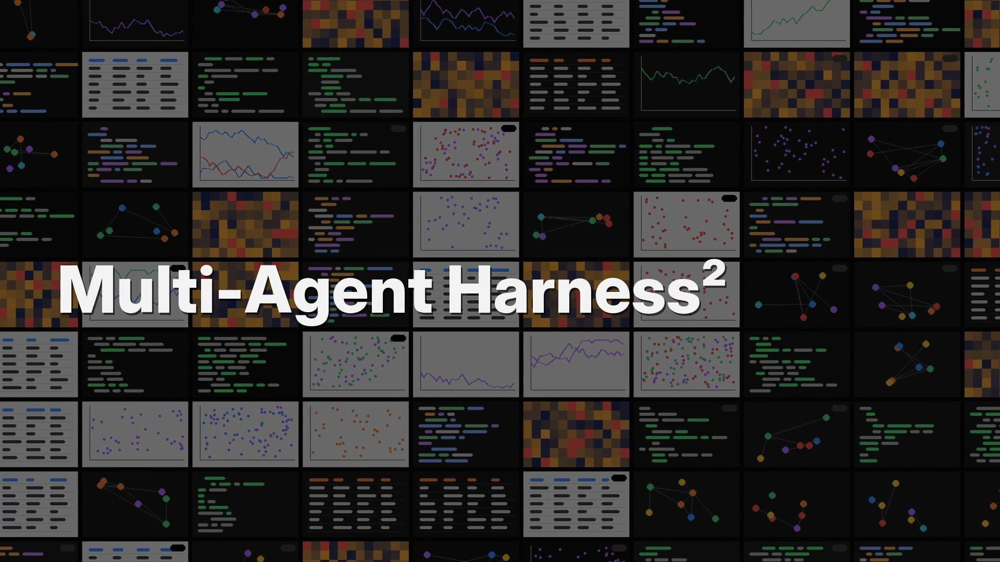
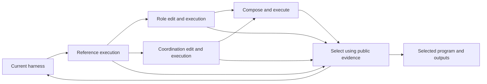

# Multi-Agent Harness²

**Give a scientific coding team a task, public data, and a budget. Let it test changes to its roles and coordination.**

Multi-Agent Harness² runs a team of seven roles, proposes separate changes to role instructions and information handoffs, executes the candidates, and selects a program using public evidence. The selected harness and runnable candidates carry into the next round. Model weights stay fixed.

[Quickstart](#quickstart) · [Your own task](#run-your-own-task) · [Setup](docs/setup.md) · [Task guide](docs/custom_tasks.md) · [Design](docs/architecture.md) · [Experiments](docs/reproduction.md)

## Launch film

Watch our 97-second introduction to Multi-Agent Harness².

[](https://weiminwu2000.github.io/blog/multi-agent-harness.html#film)

[Watch the film](https://weiminwu2000.github.io/blog/multi-agent-harness.html#film) · [Download MP4](https://github.com/WeiminWu2000/Multi-agent-harness2/raw/refs/heads/main/docs/assets/Multi-Agent-Harness2_launch.mp4)

## Quickstart

Use **Linux, Python 3.11+ and bubblewrap** (`bwrap`). Python 3.12 is used in our release checks. From this checkout:

```bash
git clone https://github.com/WeiminWu2000/Multi-agent-harness2.git
cd Multi-agent-harness2
python -m venv .venv
source .venv/bin/activate
pip install -e .
mah2 demo --output runs/demo --rounds 2
mah2 report --run runs/demo
```

The demo requires **no model credentials, downloads of upstream code, or API calls**. It uses scripted editors, real sandboxed Python executions, and the same recursive state controller as live runs. If `bwrap` is missing, install your distribution's bubblewrap package; see [setup](docs/setup.md).

The toy task joins two CSV files. A role edit fixes output ordering; a coordination edit makes the join key explicit. The composed program satisfies both public requirements:

```text
Round 1: reference 0/2 | role 1/2 | coordination 1/2 | composed 2/2 -> successor
Round 2: reference 2/2 | role 2/2 | coordination 2/2 | composed 2/2 -> reference
```

Inspect the generated Python, public checks, selected harness, and `join.csv` under `runs/demo/`. These are deterministic teaching examples, not benchmark performance claims.

## Run your own task

Install the pinned prompt dependencies and create a scientific Python environment:

```bash
mah2 setup
mah2 check --offline
mah2 init tasks/my-analysis
```

Edit `tasks/my-analysis/task.json` and put your public inputs in `tasks/my-analysis/data/`. A task packet has two fields:

```json
{
  "task_inst": "Read data/measurements.csv. Compute the mean value for each sample_id and write the requested CSV with columns sample_id,mean_value, sorted by sample_id.",
  "output_fname": "pred_results/summary.csv"
}
```

Install the packages your task needs into `.venv-science`, then configure your OpenRouter credential:

```bash
.venv-science/bin/python -m pip install pandas
export OPENROUTER_API_KEY_FILE=/path/to/private/openrouter.key
mah2 check
```

Preview the task without spending credits:

```bash
mah2 run --task tasks/my-analysis/task.json \
  --data tasks/my-analysis/data \
  --output runs/my-analysis --rounds 2 --budget 1.0 --dry-run
```

Add `--execute` instead of `--dry-run` to make paid calls:

```bash
mah2 run --task tasks/my-analysis/task.json \
  --data tasks/my-analysis/data \
  --output runs/my-analysis --rounds 2 --budget 1.0 --execute
mah2 report --run runs/my-analysis
```

The default is a free configuration check. Every live task shares one GLM allowance across the solver, editors, composition, selection, reflection, and retries. Increasing rounds divides the same task allowance across more rounds. Runs use new output directories; an existing run is never silently overwritten.

To avoid rerunning an identical composed harness, add `--reuse-identical-successor` to a Harness² run. This reuses a runnable reference or candidate from the **same round** when its full harness matches exactly and its program hash verifies. A distinct combined harness still executes. Reuse is recorded in `successor_reuse.json`, and the reused program is not added twice to selection or the archive. This optional mode was **not used in the reported benchmark results**; it saves a team execution on cache hits, but total dollar savings have not been measured.

Text and Markdown task files are supported too:

```bash
mah2 run --task analysis.md --output-file pred_results/summary.csv \
  --data data --output runs/analysis --dry-run
```

See [the task guide](docs/custom_tasks.md) for clear instructions, dependencies, resource allocation, output inspection, and failures.

## How the loop works



The role editor preserves coordination. The coordination editor preserves role instructions and changes at most one route or contract. The composer uses the original or exact tested coordination. Selection retains runnable programs with their generating harnesses and requires an executed public comparison before replacing an incumbent.

The built-in executor supports scientific Python tasks with local input files. It has analyzer, planner, coder, verifier, router, debugger, and finalizer roles. This release implements **sequential task-local recursion**. It does not provide arbitrary agent-framework adapters, parallel candidate recursion, or a cross-task experience library. These boundaries differ from upstream [Harness²](https://github.com/google-research/harness2).

## Choose a method

| `--method` | Behavior | Additional setup |
|---|---|---|
| `harness2` (default) | GLM execution, role editing and coordination editing | `mah2 setup` and OpenRouter credential |
| `base` | Same GLM team, one rollout, no outer revision | Same as default |
| `codex` | Codex coordination editor; GLM handles other stages | Codex executable and local auth; separate usage |
| `mass` | Released MASS workflow search, without model training | Separately obtained MASS and Qwen-code runtime |

All method-specific requirements are in [setup](docs/setup.md). Model settings and the historical GLM cost estimates live in `config/study.json`; use `--config` for an explicit custom configuration. Check current endpoint availability and rates before a paid run.

## Results you can inspect

`mah2 report --run runs/my-analysis` points to the selected program and deliverables and reports cost and per-round selections. Each live run records:

- `packet.json`, `config.json`, and source/input hashes;
- executed candidate programs, traces, public checks, and edit decisions;
- the selected harness and runnable-program archive;
- `commit.json`, `result.json`, and API accounting.

A successful replay means the program ran and produced its requested artifact. It is not an official scientific pass. The public runner leaves `official_success` unset; benchmark evaluation is a separate step after commitment. See [evaluation and reproduction](docs/reproduction.md).

## Research evidence

In our single-run study on 38 machine-graded ScienceAgentBench tasks, scoped GLM Harness² passed **13/38**, compared with **11/38** for both MASS workflow search and the base team. The paired comparison with MASS was inconclusive (**p = 0.754**). The stopped hybrid passed **14/35** completed tasks, with additional Codex usage. The 64 visualization tasks were excluded. The results do not establish general superiority.

Inspect the sanitized task-level results or regenerate the analysis:

```bash
python scripts/report_results.py
pip install -e '.[plots]'
python scripts/plot_results.py
```

## Development

```bash
pip install -e '.[test]'
mah2 setup --include-mass
python -m unittest discover -s tests -v
python scripts/check_release.py
```

The full regression suite includes MASS integration tests with mocked model responses. Vendor checkouts, credentials, user tasks, and generated runs are ignored and excluded from source archives. See [CONTRIBUTING.md](CONTRIBUTING.md), [SECURITY.md](SECURITY.md), and [source provenance](provenance/source.json).

## Acknowledgments and license

The task-level revision design builds on [Harness²](https://arxiv.org/abs/2610.14224). Scientific prompt builders come from [DS-STAR](https://arxiv.org/abs/2509.21825); the workflow-search adapter uses [MASS](https://arxiv.org/abs/2610.12176); benchmark results use [ScienceAgentBench](https://arxiv.org/abs/2410.05080).

Our code is Apache-2.0. Dependencies retain their own terms; see [NOTICE](NOTICE) and [CITATION.cff](CITATION.cff). MASS's upstream notice assigns no public open-source license to its code, so it is obtained separately and is not redistributed or relicensed here. This project is an independent adaptation, not an officially supported Google product.
